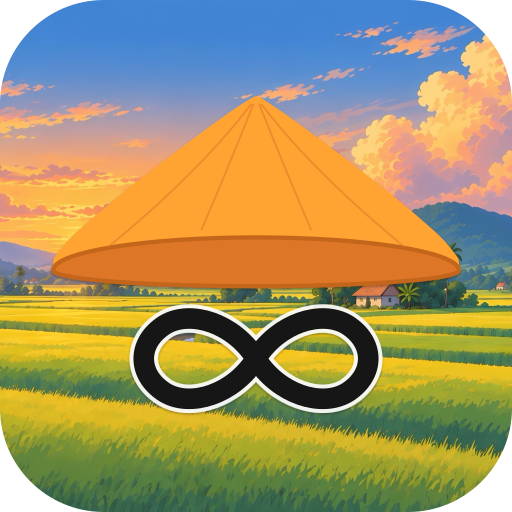
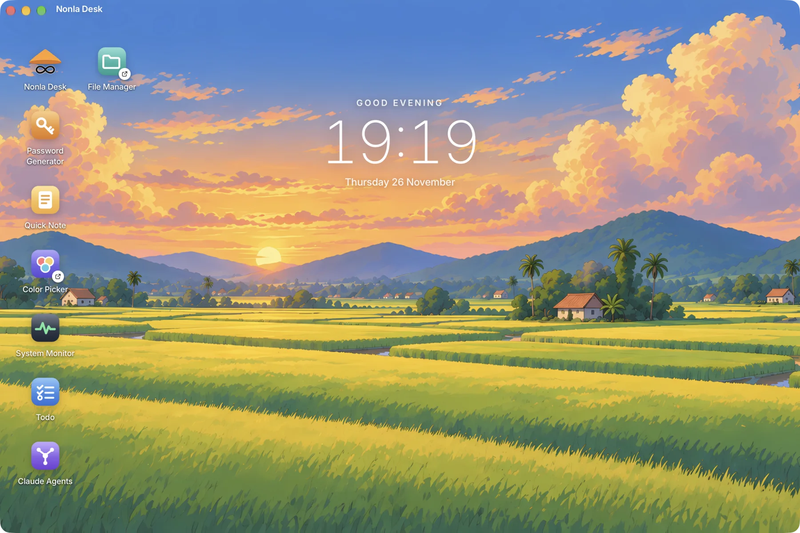
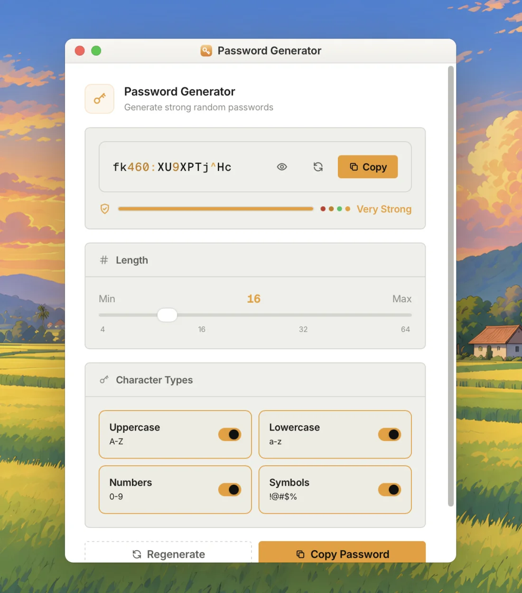
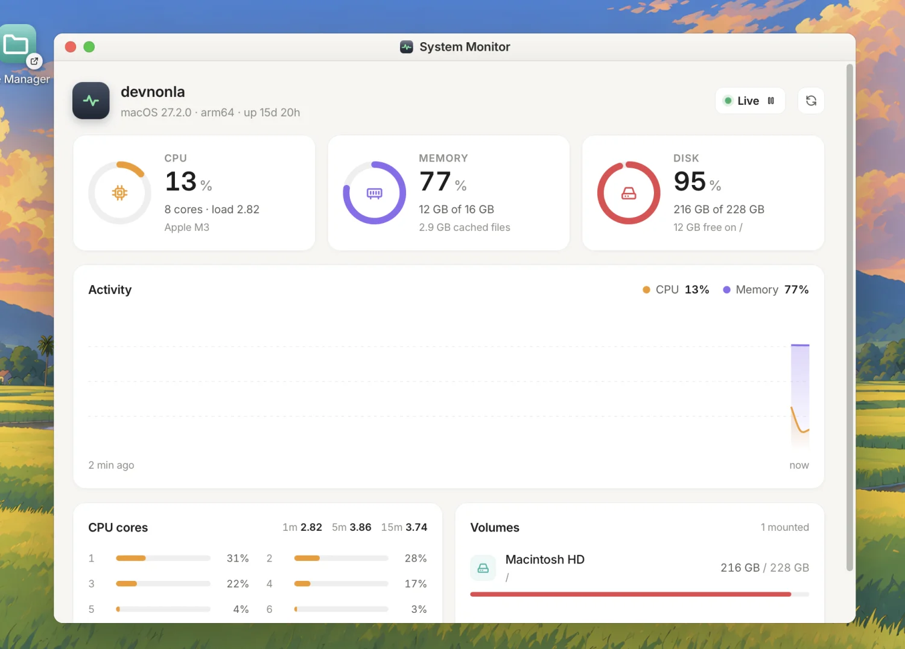
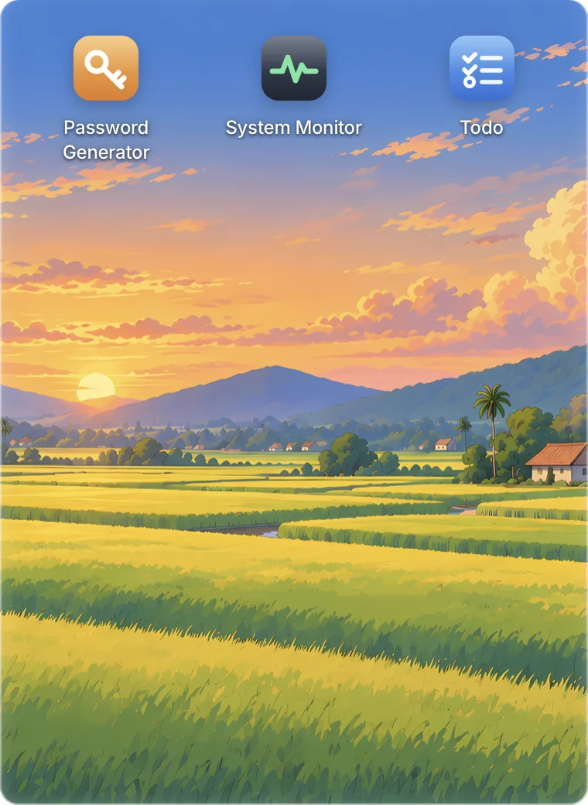
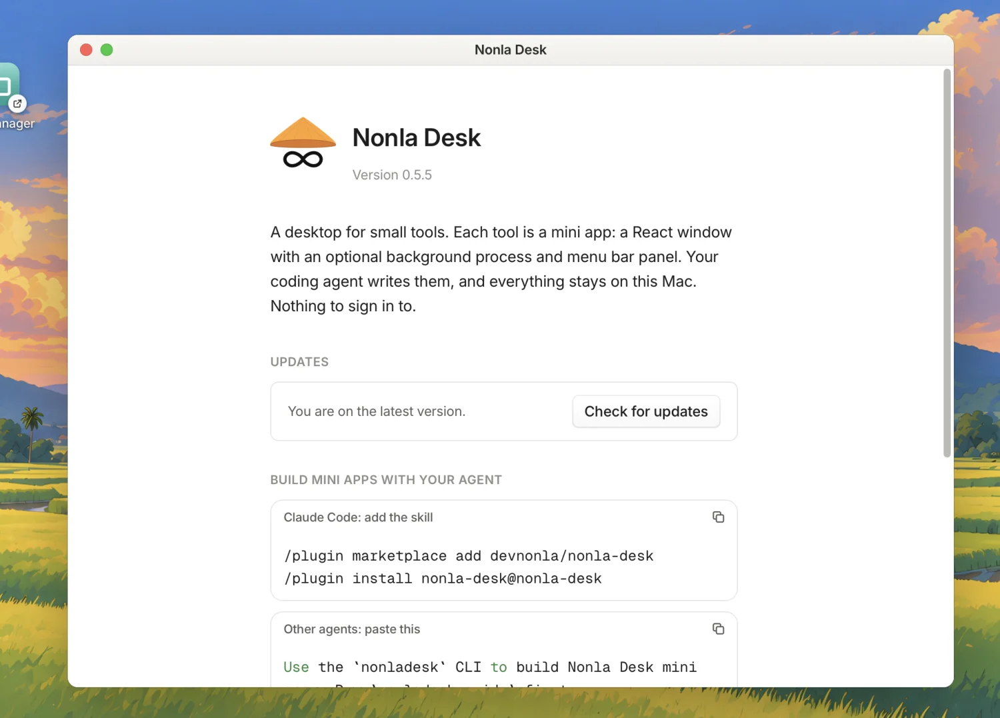
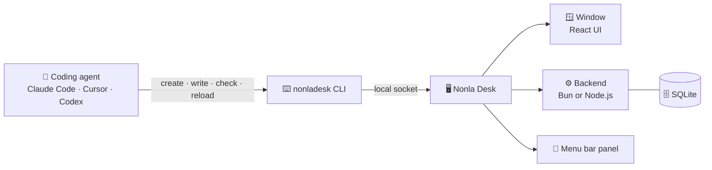

<p align="center">
  
</p>

<h1 align="center">Nonla Desk</h1>

<p align="center">
  <strong>A desktop for small tools, written by your coding agent.</strong><br>
  Ask Claude Code, Cursor or Codex for a tool. It shows up as a window, a Dock app or a menu bar panel on your Mac.<br>
  Everything runs locally. There is nothing to sign in to.
</p>

<p align="center">
  <a href="https://github.com/devnonla/nonla-desk/releases/latest"></a>
  <a href="https://github.com/devnonla/nonla-desk/releases"></a>
  
  
  <a href="LICENSE"></a>
</p>

<p align="center">
  <a href="#-install">Install</a> ·
  <a href="#-how-it-works">How it works</a> ·
  <a href="#-the-nonladesk-cli">CLI</a> ·
  <a href="#-development">Development</a>
</p>

<p align="center">
  
</p>

## ✨ Why Nonla Desk

<table>
  <tr>
    <td width="33%" valign="top">
      <h4>🧩 Tools on demand</h4>
      A tool is a <b>mini app</b>: a React window, an optional background process and an optional menu bar panel. Your agent writes it, checks it and reloads it while you watch.
    </td>
    <td width="33%" valign="top">
      <h4>🏠 Local and private</h4>
      Code lives in <code>~/.nonla-desk</code>, data in a local SQLite database. No server, no account, no API key.
    </td>
    <td width="33%" valign="top">
      <h4>🍎 Feels like a Mac app</h4>
      Menu bar icon, a panel for quick tools, and any mini app can become its own app in the Dock.
    </td>
  </tr>
</table>

## 🖼️ A look inside

<table>
  <tr>
    <td width="50%" align="center">
      
      <br><sub><b>Every tool is a window</b> — here, a password generator</sub>
    </td>
    <td width="50%" align="center">
      
      <br><sub><b>With a real backend</b> — a system monitor reading live stats</sub>
    </td>
  </tr>
  <tr>
    <td width="50%" align="center">
      
      <br><sub><b>A menu bar panel</b> for quick tools, over the same wallpaper</sub>
    </td>
    <td width="50%" align="center">
      
      <br><sub><b>The Nonla Desk page</b>: version, updates and how to add the skill to your agent</sub>
    </td>
  </tr>
</table>

## 📥 Install

### 🤖 With your agent (recommended)

Paste this into Claude Code:

```text
Install the Claude Code plugin from https://github.com/devnonla/nonla-desk (it is in plugins/nonla-desk). Then follow its skill to install the Nonla Desk app, and create a demo mini app for me.
```

The agent adds the plugin, reads the skill and installs the app (the installer also links the `nonladesk` CLI and installs [Bun](https://bun.sh)), then builds a demo mini app and opens it on your desktop.

Claude Code needs these two commands to add a plugin. If the agent can't run them for you, type them yourself:

```
/plugin marketplace add devnonla/nonla-desk
/plugin install nonla-desk@nonla-desk
```

Using another agent (Cursor, Codex…)? Put [`plugins/nonla-desk/skills/nonla-desk`](plugins/nonla-desk/skills/nonla-desk) (the `SKILL.md` and its `references/` folder) where your agent reads skills, or tell it: *Use the `nonladesk` CLI to build Nonla Desk mini apps. Run `nonladesk guide` first.*

### Install it yourself

**One-liner:**

```bash
curl -fsSL https://raw.githubusercontent.com/devnonla/nonla-desk/main/scripts/install.sh | bash
```

**Manual download:**

1. Download the latest `.dmg` from [Releases](https://github.com/devnonla/nonla-desk/releases/latest)
2. Open the `.dmg` and drag **Nonla Desk** to `/Applications`
3. Remove the quarantine flag (the app is not code-signed), and install [Bun](https://bun.sh) if you don't have it:
   ```bash
   xattr -cr /Applications/Nonla\ Desk.app
   curl -fsSL https://bun.sh/install | bash
   ```
4. Open Nonla Desk once. It links the CLI at `~/.local/bin/nonladesk`.

> **Note:** macOS Gatekeeper blocks an unsigned app on first launch unless you remove the quarantine attribute with the command above.

Nonla Desk updates itself: it checks GitHub releases 15 seconds after launch and every 10 minutes. A red dot on the **Nonla Desk** icon means an update is ready, and the menu bar icon has **Check for Updates…**.

## 🔧 How it works

Your agent never touches the app directly. It talks to the `nonladesk` CLI, and the CLI talks to the running app over a local socket (it starts the app if it is closed).



1. **Add the plugin to your agent** (see [Install](#-with-your-agent-recommended)).
2. **Ask for a tool.** The agent writes the files through the CLI, checks them, enables the app and opens it for you.
3. **Keep it around.** Nonla Desk lives in the menu bar: closing the window keeps it running, and the Dock icon steps aside until you open the window again.

While the desktop has no mini apps, a card explains how to start. Make sure `~/.local/bin` is on your `PATH`.

## 💻 The `nonladesk` CLI

Mini apps are built through this CLI, by your agent: it creates and edits the files, checks them and reloads the app. `nonladesk guide` prints the guide your agent reads first ([the same text is here](plugins/nonla-desk/skills/nonla-desk/references/develop.md)).

| Command | What it does |
|---|---|
| `nonladesk list` · `get <app>` · `path <app>` | See what exists and where the files are |
| `nonladesk create "Name" --frontend f.jsx …` | New app (starts disabled) |
| `nonladesk write <app> frontend ./file.jsx` | Replace one file; reloads the app |
| `nonladesk check <app>` | Transpile and syntax-check, before or after saving |
| `nonladesk reload <app>` | Pick up edits made in place; restarts the backend |
| `nonladesk enable <app>` · `disable <app>` | Turn an app (and its backend) on or off |
| `nonladesk logs <app>` | Backend output and crashes |
| `nonladesk open [app]` | Show Nonla Desk, or one app |
| `nonladesk install <app>` · `uninstall <app>` | Native Mac app for a mini app |
| `nonladesk import <zip>` · `export <app>` | Share an app as a `.zip` |
| `nonladesk status` · `guide` | Version, runtime and paths · the development guide |

Add `--json` for raw output. `nonladesk --help` lists everything.

Handy shortcuts in the app: **⌘K** search and open, **⌘O** import a mini app, **⌘B** back to all apps.

## 🚀 Development

### Prerequisites

- **macOS** 12.0 or later
- **Bun** >= 1.0
- **Rust** (stable, via [rustup](https://rustup.rs)) and Xcode Command Line Tools

### Setup

```bash
# Clone the repository
git clone https://github.com/devnonla/nonla-desk.git
cd nonla-desk

# Install dependencies
bun install

# Start the app in development mode (Vite + Tauri)
bun dev

# Drive the dev app from another terminal
bun nonladesk list
```

The dev app has its own database and socket, so it runs next to an installed Nonla Desk.

### Build

```bash
# Build for production — app + DMG in src-tauri/target/release/bundle/
bun run build

# Debug .app bundle (faster, uses the dev database and socket)
bunx tauri build --debug --bundles app
```

### Project structure

```
nonla-desk/
├── src/
│   ├── components/    # desktop (icons, windows, top bar), tools (mini app runtime,
│   │                  #   details, Nonla Desk page), tray (menu bar panel), solo, ui
│   ├── hooks/         # window manager, mini app change events
│   └── lib/           # Tauri bridge (api.ts), mini app helpers and checks
├── src-tauri/         # Rust core
│   ├── src/           # CLI, socket server, mini app data and backends, tray, updater
│   ├── icons/         # app icon and menu bar icon
│   └── resources/     # sandbox-runner.cjs (mini app backend host)
├── plugins/           # Claude Code plugin: skill and the mini app guide
├── docs/images/       # screenshots used in this README
└── scripts/           # install.sh
```

### Tech stack

| Layer | Technology |
|---|---|
| Framework | Tauri 2 (Rust) |
| Frontend | React 19, devnonla-ui, TypeScript 5 |
| Styling | Tailwind CSS 4 |
| Database | SQLite (rusqlite) |
| Mini app backends | Bun (or Node.js) |
| Build | Vite, Tauri CLI |
| Lint / format | Biome 2 |

### Scripts

| Command | Description |
|---|---|
| `bun dev` | Run the app in development mode |
| `bun run build` | Build the macOS app and DMG |
| `bun run build:web` | Typecheck and build the frontend |
| `bun nonladesk <cmd>` | Run the CLI against the dev app |
| `bun run lint` | Run linter |
| `bun run format` | Format code |
| `bun run check` | Lint + format (auto-fix) |

## 🤝 Contributing

Contributions are welcome! Please read the [Contributing Guide](CONTRIBUTING.md) before submitting a Pull Request.

## 📄 License

This project is licensed under the [MIT License](LICENSE).
