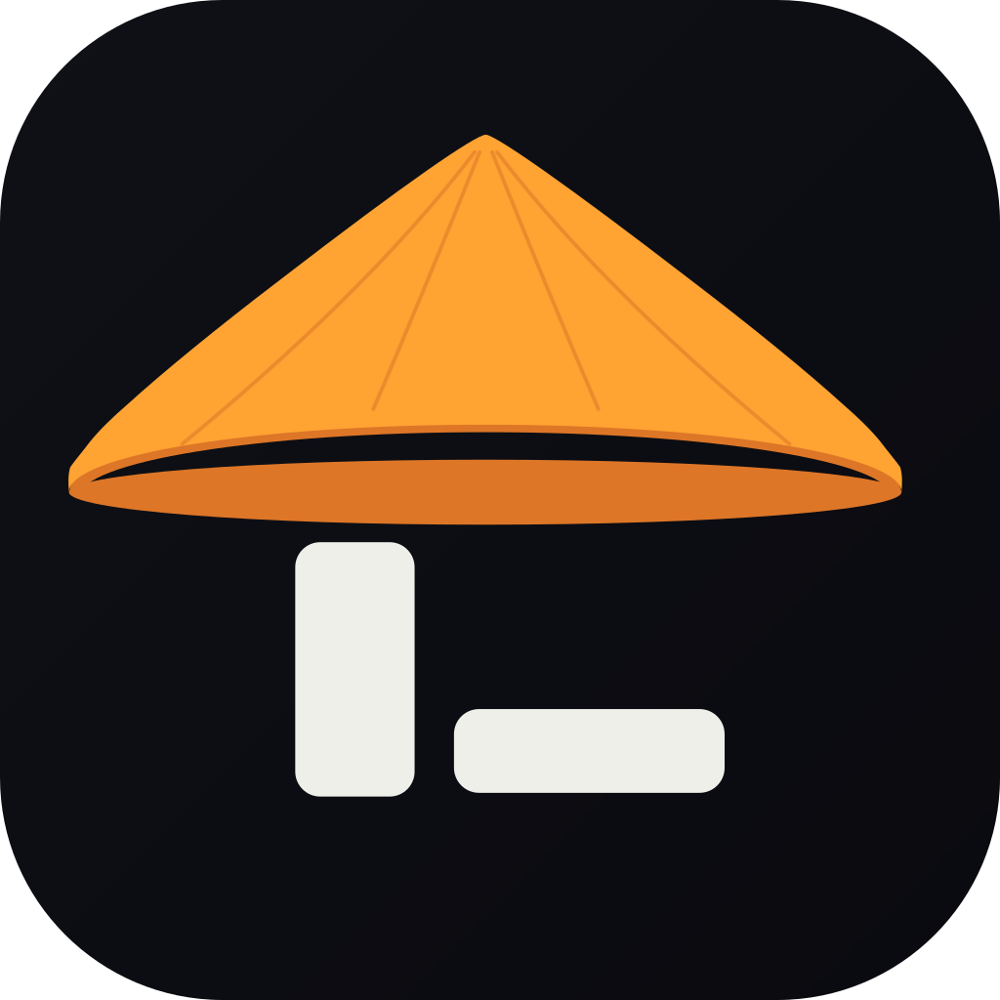

<p align="center">
  
</p>

<h1 align="center">Nonla Desk</h1>

<p align="center">
  <strong>Developer utilities desktop app for macOS</strong>
</p>

<p align="center">
  <a href="https://github.com/devnonla/nonla-desk/releases"></a>
  <a href="https://github.com/devnonla/nonla-desk/blob/main/LICENSE"></a>
</p>

---

## ✨ Features

- 🧩 **Mini App Platform** — Mini apps with a React/JSX frontend, an optional backend (Bun or Node.js) and a menu bar panel
- ⌨️ **`nonla` CLI** — Coding agents (Claude Code, Cursor, Codex…) create, check, reload and debug mini apps from the terminal
- 🖥️ **Menu Bar App** — System tray with a quick access panel for everyday developer utilities
- 💾 **Local SQLite** — Persistent storage for mini app data and configurations
- ⚡ **Built with Tauri 2 (Rust) + React + TypeScript**

## 📥 Install

### One-liner (recommended)

```bash
curl -fsSL https://raw.githubusercontent.com/devnonla/nonla-desk/main/scripts/install.sh | bash
```

### Manual download

1. Download the latest `.dmg` from [Releases](https://github.com/devnonla/nonla-desk/releases/latest)
2. Open the `.dmg` and drag **Nonla Desk** to `/Applications`
3. Remove the quarantine flag (app is unsigned), and install [Bun](https://bun.sh) if you don't have it (mini app backends run on it):
   ```bash
   xattr -cr /Applications/Nonla\ Desk.app
   curl -fsSL https://bun.sh/install | bash
   ```
4. Open Nonla Desk once. It links the CLI at `~/.local/bin/nonla`.

> **Note:** The app is not code-signed. macOS Gatekeeper will block it on first launch unless you remove the quarantine attribute with the command above.

## First launch

Mini apps (tools) are written by your coding agent through the `nonla` CLI. While the desktop has no mini apps, a card explains how to start.

1. Open **Nonla Desk**. It lives in the menu bar; closing the window keeps it running.
2. `nonla` is linked at `~/.local/bin/nonla`; make sure that folder is on your PATH.
3. Give your agent the skill:
   - Claude Code: `/plugin marketplace add devnonla/nonla-desk`, then `/plugin install nonla-desk@nonla-desk`
   - Other agents: *Use the `nonla` CLI to build Nonla Desk mini apps. Run `nonla guide` first.*
4. The agent writes files, then runs `nonla create`, `nonla check`, `nonla enable`, `nonla reload` and `nonla logs`.

The CLI talks to the running app over a local socket and starts the app if it is closed. There is nothing to sign in to. `nonla --help` lists every command.

Nonla Desk updates itself: it checks GitHub releases at launch and every 6 hours, and the menu bar icon has **Check for Updates…**.

## 🚀 Development

### Prerequisites

- **macOS** 12.0 or later
- **Bun** >= 1.0
- **Rust** (stable, via [rustup](https://rustup.rs)) and Xcode Command Line Tools

### Setup

```bash
# Clone the repository
git clone https://github.com/devnonla/nonla-desk.git
cd nonla-desk

# Install dependencies
bun install

# Start the app in development mode (Vite + Tauri)
bun dev

# Drive the dev app from another terminal
bun nonla list
```

### Build

```bash
# Build for production — app + DMG in src-tauri/target/release/bundle/
bun run build

# Debug .app bundle (faster, uses the dev database and socket)
bunx tauri build --debug --bundles app
```

## 🏗️ Project Structure

```
nonla-desk/
├── src/
│   ├── components/    # Desktop, windows, settings, mini app runtime UI
│   └── lib/           # Tauri bridge (api.ts), mini app helpers
├── src-tauri/         # Rust core: DB, mini app runtime, CLI, tray
│   ├── src/
│   └── resources/     # sandbox-runner.cjs (mini app backend host)
├── scripts/           # install.sh
├── vite.config.ts
└── package.json
```

## 🛠️ Tech Stack

| Layer       | Technology                        |
|-------------|-----------------------------------|
| Framework   | Tauri 2 (Rust)                    |
| Frontend    | React 19, React Router 7, devnonla-ui |
| Styling     | Tailwind CSS 4                   |
| Database    | SQLite (rusqlite)                |
| Mini app backends | Bun (or Node.js)           |
| Build       | Vite, Tauri CLI                  |
| Lint/Format | Biome 2                          |
| Language    | TypeScript 5                     |

## 📝 Scripts

| Command                | Description                      |
|------------------------|----------------------------------|
| `bun dev`              | Run the app in development mode  |
| `bun run build`        | Build the macOS app and DMG      |
| `bun run build:web`    | Typecheck and build the frontend |
| `bun nonla <cmd>`      | Run the CLI against the dev app  |
| `bun run lint`         | Run linter                       |
| `bun run format`       | Format code                      |
| `bun run check`        | Lint + format (auto-fix)         |

## 🤝 Contributing

Contributions are welcome! Please read the [Contributing Guide](CONTRIBUTING.md) before submitting a Pull Request.

## 📄 License

This project is licensed under the [MIT License](LICENSE).
